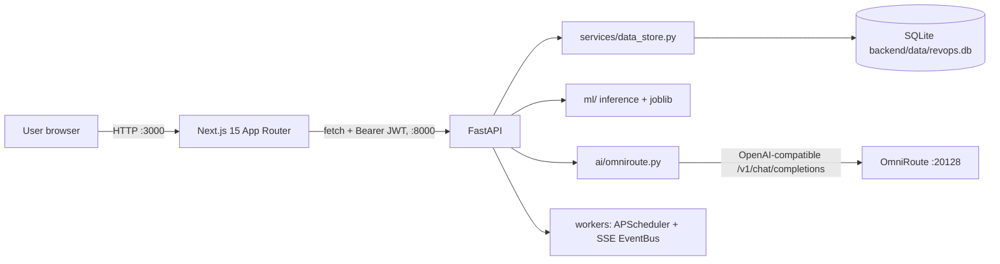
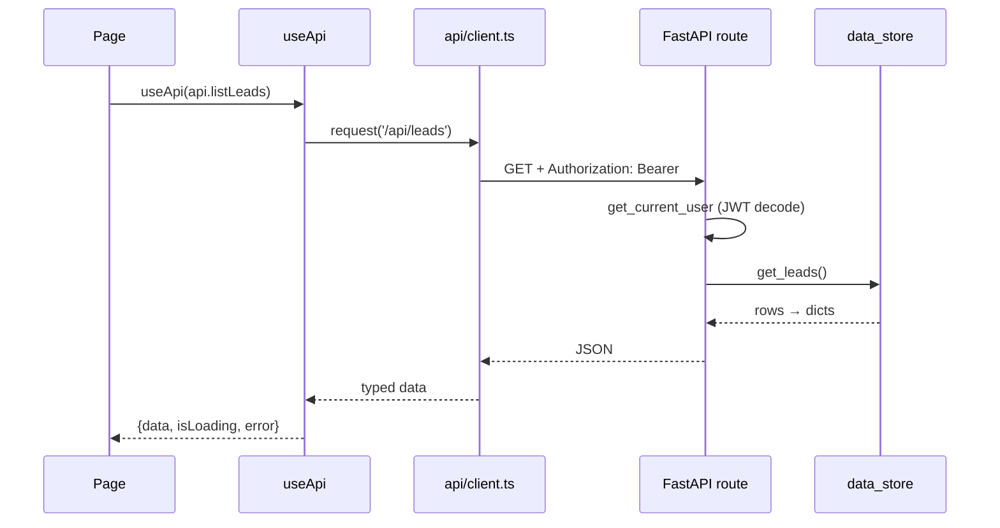

# ARCHITECTURE.md — RevOps Pro

For humans and agents. Intent/rules live in `CLAUDE.md`; this file is the map.

## 1. Context



Runtime ports: frontend **3000**, backend **8000**, OmniRoute **20128** (external tool, not in this repo).
Swagger: `http://127.0.0.1:8000/docs`.

## 2. Repository map

```
revops-platform/
├─ backend/
│  ├─ app/
│  │  ├─ main.py               FastAPI app, CORS, routers, lifespan (init_db, scheduler)
│  │  ├─ core/                 config.py (Settings), security.py (bcrypt, JWT, require_role)
│  │  ├─ api/                  routes_{auth,crm,ml,analytics,alerts,admin,copilot,events}.py, deps.py
│  │  ├─ services/             data_store.py (repository), exec_summary.py, alert_engine.py
│  │  ├─ database/             connection.py (engine, ORM models, init_db)
│  │  ├─ schemas/              Pydantic models (__init__.py)
│  │  ├─ repositories/         empty — data_store.py plays this role today
│  │  ├─ ml/{artifacts,inference,training}/
│  │  ├─ ai/                   omniroute.py (client), copilot.py
│  │  └─ workers/              scheduler.py, jobs.py, realtime.py (EventBus)
│  ├─ data/                    revops.db + CSV seeds
│  ├─ seed/                    CSV seed source
│  ├─ scripts/                 seed_loader.py, seed_data.py, seed_fetch.py, create_user.py
│  ├─ test_api.py              pytest suite
│  └─ .env / .env.example
├─ frontend/
│  ├─ app/                     App Router: /, /login, /dashboard/**
│  ├─ src/{api,components,contexts,hooks,lib}/  + index.css (tokens, glass, keyframes)
│  └─ .env.local               NEXT_PUBLIC_API_URL
├─ scripts/start-dev.{ps1,sh}
└─ *.md                        CLAUDE, AGENTS, ARCHITECTURE, DESIGN, MEMORY, CHECKPOINT, README, CHANGELOG
```

## 3. Data model (SQLite, SQLAlchemy models in `database/connection.py`)

| Table | Key columns |
|---|---|
| `users` | id, name, email (unique), hashed_password (bcrypt), role (`admin`/`manager`/`sales-executive`), status, last_login |
| `leads` | id, name, email, company, status, source, value, industry, company_size, touchpoints, ai_score, ai_label, ai_factors(JSON) |
| `deals` | id, title, company, value, probability, owner, close_date, stage, ai_recommendation, is_anomalous, days_in_stage |
| `accounts` | id, name, industry, contract_value, last_activity_days, usage_trend, ticket_count, renewal_in_days, health_score |
| `activities` | id, deal_id, lead_id, type, author, content, created_at |
| `notifications` / `alerts` | read flag; alerts carry kind (`stale_deal`, `risk_crossing`, `high_value_stall`), severity, entity_type/id |
| `audit_log` | user, action, resource, type, timestamp, ip |
| `model_registry` | name (PK), version, trained_at, accuracy, kind, notes |
| `metric_snapshots` | metric_name, value, snapshot_at |

Deal stages: `prospecting → qualification → proposal → negotiation → closed-won | closed-lost`.

## 4. API surface (60 operations) and access

| Group | Paths | Access |
|---|---|---|
| Health/root | `GET /`, `/health`, `/api/health` | Public |
| Auth | `POST /api/auth/login` (form), `GET /api/auth/me`, `POST /api/auth/register` | Public / Bearer / Public |
| CRM | `/api/leads[/{id}|/export|/import]`, `/api/deals[...]`, `/api/accounts[...]`, `/api/activities[...]` | Bearer |
| ML | `/api/predict/{lead-score,revenue-forecast,pipeline-insights,anomalies,churn-risk,next-best-actions}`, `POST /api/predict` | Bearer |
| Analytics | `/api/analytics/{exec-summary,funnel,cohorts,trends,revenue-history,forecast-scenario}` | Bearer |
| Alerts/Notifications | `/api/alerts[...]`, `/api/notifications[...]` | Bearer |
| Copilot | `POST /api/copilot/ask` | Bearer |
| Admin/Users | `/api/users[...]`, `/api/admin/{stats,activity,models,models/{name}/retrain}` | **admin only** |
| Realtime | `GET /api/events/stream` (SSE) | currently Public — see CHECKPOINT |

Roles: `sales-executive (1) < manager (2) < admin (3)`. Only user-management and admin routes are role-gated today; all authenticated users can read all CRM rows.

## 5. ML & AI components

| Component | File | Notes |
|---|---|---|
| Lead scoring | `ml/artifacts/lead_scoring_model.py` + `.joblib` | score 0–100, label, factors |
| Churn risk | `ml/artifacts/churn_model.py` + `.joblib` | `top_factors` are rule-derived text, not SHAP |
| Anomaly detection | `ml/artifacts/anomaly_detector.py` + `.joblib` | IsolationForest over deal features |
| Revenue forecast | `ml/inference/revenue_forecast_model.py` | ridge / linear / gradient boosting on monthly closed-won revenue |
| Pipeline insights / NBA | `ml/inference/{insights_engine,next_best_action}.py` | rule + model hybrid |
| Copilot | `ai/copilot.py` | live KPIs → OmniRoute; labelled `local-rules` fallback |

## 6. Frontend routes

| Route | Purpose | Access |
|---|---|---|
| `/` | Public landing (currently one hero page) | public |
| `/login` | Email + password | public |
| `/dashboard` | KPI overview | authed |
| `/dashboard/{leads,pipeline,accounts,forecast,analytics,copilot,alerts}` | feature pages | authed |
| `/dashboard/admin` | system stats, models, audit | admin (sidebar hides it otherwise) |

Every dashboard page = `DashboardLayout` (Sidebar + TopBar + animated content) + `useApi(...)` calls through `src/api/client.ts`. Unauthed users are redirected to `/login` by `DashboardLayout`.

## 7. Sequence: authenticated read



## 8. Configuration

Backend `backend/.env` (loaded by `core/config.py`): `DATABASE_URL`, `JWT_SECRET_KEY`, `JWT_EXPIRE_MINUTES`, `OMNIROUTE_BASE_URL`, `OMNIROUTE_API_KEY`, `OMNIROUTE_MODEL`, `CORS_ORIGINS`, `ENVIRONMENT`, `SCHEDULER_ENABLED`.
Frontend `frontend/.env.local`: `NEXT_PUBLIC_API_URL=http://127.0.0.1:8000`.

## 9. Known drift at audit time (2026-09-21)

Tracked with root causes in `CHECKPOINT.md`: empty `TopBar.tsx` (dashboard cannot compile) · corrupted `src/index.css` (landing page invisible) · empty `.env.local` · empty `scripts/create_user.py` · OmniRoute URL built as `…/v1/v1/…` · public register allows `admin` · in-sample "accuracy" · hardcoded admin stats · stale 2024-only data · README lists `/dashboard/deals` & `/notifications` that don't exist.
